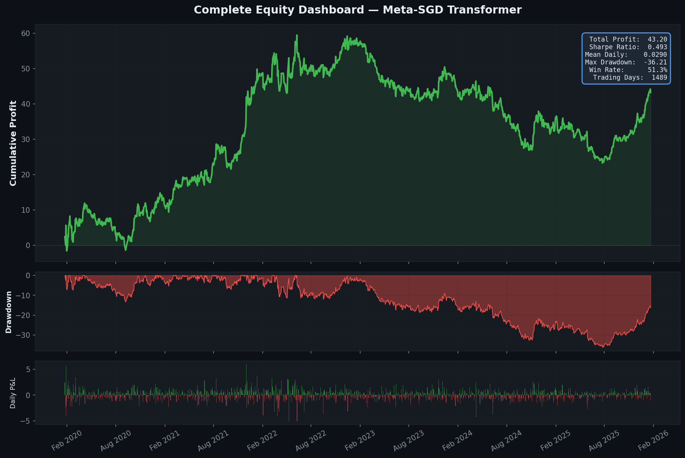
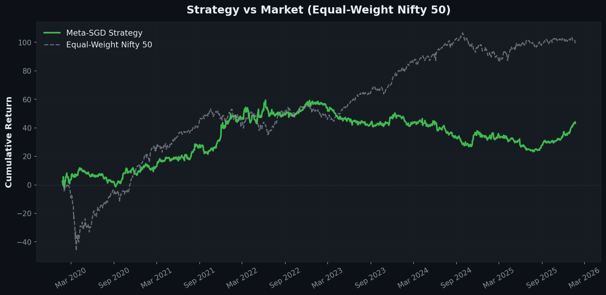
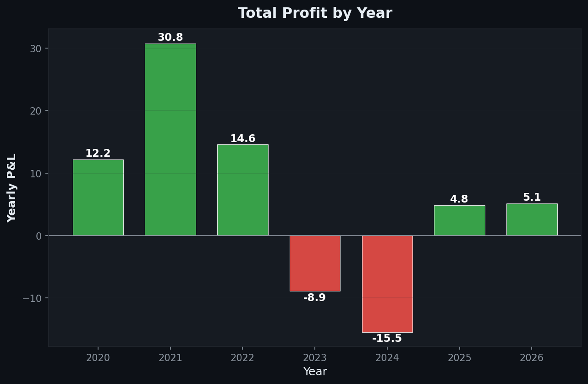
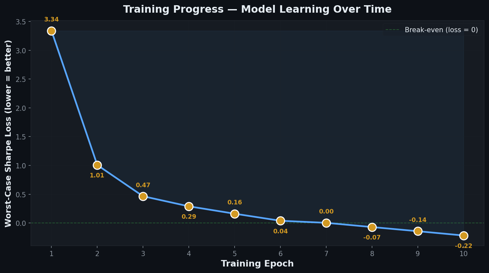

# Meta-Learning for Nifty 50 Daily Trading Signals (Numin2)

Markets keep switching regimes, so a model trained once on past data goes stale. This project
treats trading as a stream of few-shot adaptation tasks. A Transformer encoder is meta-trained
with **Meta-SGD** (learned per-parameter inner learning rates) and **Sharpness-Aware Minimization
(SAM)** to produce daily long / short / cash signals for the 50 Nifty 50 stocks. At test time it
adapts online to the most recent block of data before each prediction, and a conviction-based
allocator with turnover inertia turns its scores into discrete `+1 / 0 / -1` positions that are
backtested with the Numin2 API under transaction costs.

> Educational project. Nothing here is financial advice.



## Key results

Final model (Meta-SGD + SAM + L1 sparsity + online adaptation), on the out-of-sample test split,
with the Numin2 backtester's transaction cost set to `txn_cost=0.1` (described in the project as a
10 bps fee). Source: [project presentation](docs/meta-learning-numin2-presentation.pdf), slides 1,
7 and 8, plus the stats box in the equity dashboard above.

| Metric | Value |
|---|---|
| Total profit | **+43.20** |
| Sharpe ratio | **0.493** |
| Win rate | 51.3% |
| Max drawdown | -36.21 |
| Mean daily return | 0.0290 |
| Out-of-sample trading days | 1,489 |

"Profit" is the Numin2 backtester's sum of daily net portfolio returns, in the dataset's return
units, after transaction costs.

**Ablation study** (presentation, slide 7):

| # | Configuration | Allocator | Top-K | Inertia | Total profit | Sharpe |
|---|---|---|---|---|---|---|
| 1 | Returns-only features (no OHLCV) | Absolute | 2 | 0.4 | +20.58 | 0.227 |
| 2 | Full OHLCV + Meta-SGD + SAM | Strict discrete | 4 | — | -1.64 | -0.024 |
| 3 | Online adaptation + lazy stat-arb | Lazy stat-arb | 2 | 1.5 | +25.84 | 0.34 |
| **Final** | **Meta-SGD + SAM + L1 + online adaptation** | **Absolute** | **2** | **0.4** | **+43.20** | **0.493** |

The four code cells of [`notebooks/numin_meta_sgd.ipynb`](notebooks/numin_meta_sgd.ipynb) use these
four configurations (matched by their hyperparameters). An earlier work-in-progress version
([`notebooks/archive/numin_v1_wip.ipynb`](notebooks/archive/numin_v1_wip.ipynb)) printed a total
profit of 17.3244 and a Sharpe of 0.1875 over the same 1,489 test days. That figure comes from the
notebook's saved output.

**Comparison with the market.** Over the full test window, a passive equal-weight Nifty 50
portfolio finished with a higher cumulative return than the strategy. The strategy's drawdown
during the early-2020 crash was much smaller, because it mostly sits in cash and holds at most
two longs and two shorts at a time.



Yearly P&L was positive in 2020-2022 and 2025, and negative in 2023 (-8.9) and 2024 (-15.5).
2026 covers January only.



More charts are in [`docs/figures/`](docs/figures/): a monthly P&L heatmap, rolling Sharpe, best and
worst days, and the data split. All charts were taken from the project presentation. The plotting
code is not part of the notebooks.

## Method overview

The final model is Experiment 4 in `notebooks/numin_meta_sgd.ipynb`.

1. **Data and split.** The daily OHLCV and returns files for the 50 stocks are merged into a
   `[days, 50, 6]` tensor (open, high, low, close, volume, return). Each sample is a 252-day window,
   and its target is the next day's return for every stock. The windows are split by time,
   70% / 15% / 15%, into train / validation / test, with no shuffling.
2. **Features** (computed inside the model, per stock and day): raw return,
   Garman-Klass volatility, relative volume (volume divided by its 20-day average),
   cross-sectional z-score of returns, and 60-day momentum.
3. **Backbone.** A linear projection feeds sinusoidal positional encoding and a 4-layer Transformer
   encoder (`d_model=256`, 8 heads, GELU, dropout 0.3). An MLP head (Linear, LayerNorm, GELU, Linear)
   with `tanh` outputs one score in `[-1, 1]` per stock.
4. **Meta-training (Meta-SGD + SAM).** Consecutive training batches are paired as (support, query).
   - The inner step takes one gradient step on the support batch with an MSE loss, using a learned
     per-parameter learning rate (initialised at 0.005).
   - The adapted weights are scored on the query batch with a differentiable, turnover-penalised
     Sharpe loss (`txn_cost=0.1`), plus an L1 penalty (`0.5 * mean|pred|`) that pushes the model
     towards zero (cash) when it is unsure.
   - SAM (`rho=0.05`, AdamW `lr=3e-4`, weight decay `1e-4`) repeats the inner adaptation from the
     perturbed weights and updates on the worst-case loss.
   - Training runs for 10 epochs with batch size 128.
5. **Online adaptation (test time).** Before predicting each block of 128 test days, the model
   takes one Meta-SGD step on the previous block, whose targets are already known. It applies the
   adapted weights through `torch.func.functional_call`, so the global weights stay unchanged.
6. **Absolute Conviction allocator.** Positions are `+1` for up to the top 2 stocks and `-1` for up
   to the bottom 2, and only when the score magnitude is above 0.6. A stock already held gets an
   inertia bonus of 0.4, so it is easier to keep than to enter, which cuts turnover. If there are no
   positions, the portfolio is 100% cash.
7. **Backtest.** The 51-column position matrix (cash plus 50 stocks) is scored with
   `Numin2API().backtest_positions(..., txn_cost=0.1)`.



The presentation reports the worst-case (SAM) Sharpe loss falling from 3.34 to -0.22 over 10
epochs (slide 6).

### Limitations

- The final notebook was saved without outputs. The headline numbers come from the presentation
  and have not been re-run here.
- There are no random seeds, and each configuration was run once.
- The validation split is created but not used. The configurations and allocator settings were
  compared on the same out-of-sample period, so the results are not a clean hold-out estimate.
- The strategy beat the passive benchmark on drawdown, not on cumulative return.

## Repository structure

```
.
├── notebooks/
│   ├── numin_meta_sgd.ipynb        # final notebook: 4 self-contained experiment cells (cell 4 = final model)
│   └── archive/
│       └── numin_v1_wip.ipynb      # earlier WIP version, with saved training log + equity curve
├── docs/
│   ├── meta-learning-numin2-presentation.pdf   # project presentation (results, ablations)
│   └── figures/                    # charts extracted from the presentation
├── data/                           # put the Numin2 parquet files here (not committed)
├── requirements.txt
├── LICENSE
└── README.md
```

## Setup and reproduction

The original runs used Python 3.10, and `numin2` requires Python >= 3.10. A CUDA GPU is strongly
recommended. In the archived run, each meta-training epoch took about 86 s on GPU.

```bash
python -m venv .venv && source .venv/bin/activate
pip install -r requirements.txt
```

**Data.** The dataset is not included. It is distributed through the Numin2 platform, and the
`numin2` package downloads it. Run this from the repository root:

```python
from numin2 import Numin2API

api = Numin2API()
api.download_data("data/consolidated_daily_ohlcv.parquet", type="daily", features="ohlcv")
api.download_data("data/consolidated_daily_returns.parquet", type="daily", features="returns")
```

**Run.** Start Jupyter from the repository root and open `notebooks/numin_meta_sgd.ipynb`. Each code
cell is a complete experiment that trains, adapts and backtests in one go. Run the last cell for
the final model. The notebooks read the data from `../data/`.

Notes:

- The cells pick `cuda:1` when CUDA is available. On a single-GPU machine, change it to `cuda` or
  `cuda:0`.
- The backtest calls `Numin2API()`, which connects to the Numin2 service, so you need network access.

## Context

This was an assignment for a Meta & Transfer Learning course: apply meta-learning to the Numin2
Nifty 50 dataset to produce daily buy / hold / sell signals, evaluated with the Numin2 backtester.

## License

[MIT](LICENSE)
